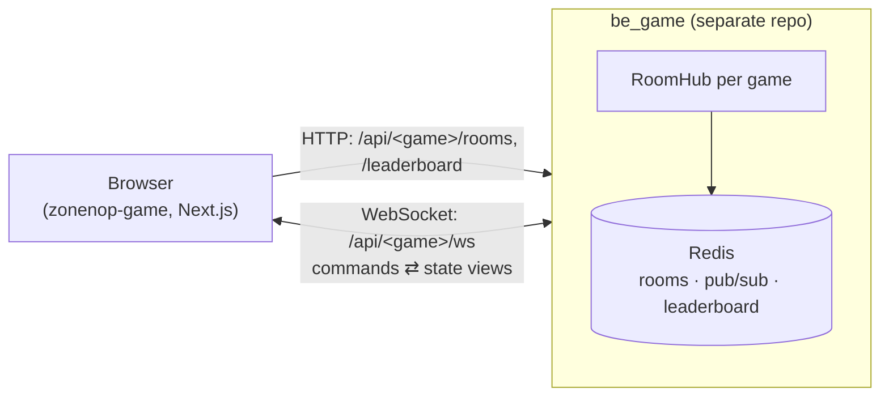

# 🎮 zonenop-game

**Vietnamese board & card games you can play online with friends — no sign-up, no install, right in the browser.**

Create a table, share the invite link, and play Tiến Lên, Mèo Nổ, Cờ Tỷ Phú and more in real time, on desktop or phone.

[](https://nextjs.org/)
[](https://react.dev/)
[](https://www.typescriptlang.org/)
[](https://tailwindcss.com/)
[](#-deployment)
[](LICENSE)

---

## Table of contents

- [Games](#-games)
- [Features](#-features)
- [Architecture](#-architecture)
- [Tech stack](#-tech-stack)
- [Project structure](#-project-structure)
- [Getting started](#-getting-started)
- [Configuration](#-configuration)
- [Scripts & quality checks](#-scripts--quality-checks)
- [Deployment](#-deployment)
- [Adding a new game](#-adding-a-new-game)
- [Contributing](#-contributing)
- [Documentation](#-documentation)
- [License](#-license)

---

## 🃏 Games

| | Game | Players | Highlights | Route |
|---|---|---|---|---|
| 🃏 | **Tiến Lên Miền Nam** | 2–4 | Chặt heo, tới trắng, configurable rank points, spectators & emoji | `/tien-len` |
| 😼 | **Mèo Nổ** (Exploding Kittens-style) | 2–7 | "Không!" chains, 6 expansion packs, 16 preset combos or custom picks, per-card guide | `/meo-no` |
| 🎩 | **Cờ Tỷ Phú** (Monopoly-style) | 2–6 | Vietnamese provinces, 3 map sizes, houses & rent, trading, quick rule presets | `/co-ty-phu` |
| 💎 | **Đá Quý** (Splendor-style) | 2–4 | Illustrated cards, nobles and gem tokens | `/splendor` |
| 🤠 | **Đấu Súng** (Bang!-style) | 3–8 | Secret roles, 63 characters, 7 expansions | `/bang` |
| 🐴 | **Cờ Cá Ngựa** (Vietnamese ludo) | 2–4 | Dice, kicking opponents home, 6-step stable climb | `/co-ca-ngua` |
| 🪨 | **Ô Ăn Quan** | 2–4 | Traditional sowing game, quan non, 5- or 10-stone quan | `/o-an-quan` |
| 🔫 | **Contra** | 1 | 8-bit side-scrolling shooter on `<canvas>`, fully offline | `/contra` |

Every online table lives at `/<game>/<ROOM>`; add `?watch=1` to join as a spectator.

## ✨ Features

**Playing together**
- **Instant tables** — create a room, copy the invite link, friends join with just a name. No accounts.
- **Real-time play over WebSockets**, with automatic reconnect: a reload or a flaky phone connection keeps your seat (secret per-tab reconnect token).
- **Spectator mode** for every table, plus in-table **chat and emoji reactions**.
- **Lobby & "open tables" panel** listing waiting and in-progress tables of every game.
- **All-time leaderboards** per game.

**Player experience**
- One **player profile** (name, icon and colour) shared by every game.
- **Mobile-first tables** that fit one screen, including phones held sideways (`short:` variant, ≥ 36 px tap targets, pinch-zoom on large boards).
- **Keyboard shortcuts** on desktop, shown as `<kbd>` hints on the buttons they trigger.
- Turn indicators, move history, scoreboards and a win celebration at the end of each game.
- Respects the OS **reduced-motion** setting (game-state animations stay).

**Engineering**
- The UI is a thin, typed client over the **[be_game](https://github.com/ThachHuynhIT/be_game)** backend; rules are validated client-side from shared protocol copies.
- Light on the backend: lobby polling pauses in background tabs, and identical requests are shared.
- **Card-art pipeline** (`sharp`) that turns source sprite sheets into optimised WebP.
- Self-hosted with **Docker** (Next.js standalone image) and continuous deployment over Tailscale.

## 🏛️ Architecture



- **This repo is frontend only** — no database, no auth. Rooms, game state, timers and WebSockets live in the separate **be_game** repo, reached via `NEXT_PUBLIC_TIENLEN_SERVER_URL`.
- The server is authoritative: the client sends commands, the server answers with a per-player **view** of the state (your hand, never anyone else's).
- `src/lib/<game>/` holds client copies of be_game's rules and protocol, used to validate moves and render state. **Keep them in sync** with be_game when either side changes.
- The hub (`/`) and every game route share one shell (`GamesShell`): top bar with game tabs, player profile, open-tables panel and footer.

## 🛠️ Tech stack

| Layer | Technology |
|---|---|
| Framework | [Next.js 16](https://nextjs.org/) (App Router, Turbopack), [React 19](https://react.dev/) |
| Language | TypeScript 5 (strict) |
| Styling | Tailwind CSS 4, SCSS Modules, [shadcn/ui](https://ui.shadcn.com/) on [Base UI](https://base-ui.com/) |
| Animation | [`motion`](https://motion.dev/) (`LazyMotion` + `domMax`), `@formkit/auto-animate`, `@number-flow/react`, `canvas-confetti` |
| Gestures | `@use-gesture/react` (pinch-zoom) |
| Testing | [Vitest](https://vitest.dev/) |
| Tooling | ESLint (`eslint-config-next`), `sharp` (card art) |
| Delivery | Docker (standalone output), Traefik + Cloudflare Tunnel, GitHub Actions |

## 📁 Project structure

```
src/
├── app/
│   ├── page.tsx                  # Hub at "/" (game cards)
│   ├── layout.tsx                # Root layout: fonts, theme, LazyMotion
│   ├── globals.css               # Theme tokens + shared game-shell CSS
│   ├── <game>/                   # tien-len, meo-no, co-ty-phu, splendor, bang, o-an-quan, co-ca-ngua
│   │   ├── layout.tsx            #   metadata + per-game backdrop + <GamesShell>
│   │   ├── page.tsx              #   lobby (<GameLobby>)
│   │   └── [room]/page.tsx       #   table
│   └── contra/page.tsx           # Offline canvas game
├── components/
│   ├── games/                    # Shared framework: GamesShell, GameLobby, AllRoomsPanel, ChatBox,
│   │                             #   gameClient.ts (HTTP + WebSocket client), gamesRegistry.ts, hotkeys…
│   ├── <game>/                   # Table UI per game (tienlen, meono, typhu, splendor, bang, oanquan, cangua)
│   ├── game/ContraGame.tsx       # Contra engine
│   ├── ui/                       # shadcn/ui primitives
│   └── motion/                   # Shared animation helpers
├── lib/<game>/                   # Client copies of be_game rules & protocol (keep in sync)
└── styles/                       # Shared SCSS variables & mixins
public/games/                     # Card, gem and noble artwork (WebP)
scripts/card-art.mjs              # Card-art pipeline
docs/                             # GAMES_GUIDE, CHANGELOG, art prompts
```

## 🚀 Getting started

**Prerequisites:** Node.js 22+ and npm. For online games you also need a running [be_game](https://github.com/ThachHuynhIT/be_game) backend.

```bash
# 1. Backend (in the be_game repo) — uses an in-memory store when no Redis is configured
npm install && npm run dev            # http://localhost:4000

# 2. Frontend (this repo)
cp .env.example .env                  # NEXT_PUBLIC_TIENLEN_SERVER_URL=http://localhost:4000
npm install
npm run dev                           # http://localhost:3000
```

Open <http://localhost:3000>, pick a name, create a table and open the invite link in a second browser (or a private window) to play against yourself. Contra works without the backend.

## ⚙️ Configuration

| Variable | Required | Description |
|---|---|---|
| `NEXT_PUBLIC_TIENLEN_SERVER_URL` | ✅ | be_game base URL, no trailing slash (default `http://localhost:4000`). Inlined at **build time**. |
| `NEXT_PUBLIC_TIENLEN_FALLBACK_URL` | — | Backup be_game backend. While the main one does not answer (`GET /api/rooms`, 3 s), lobbies and new rooms use it; each room stays on the backend it was created on (separate Redis). Inlined at **build time**. |
| `NEXT_PUBLIC_SITE_URL` | — | Public origin used for metadata (`metadataBase`). |
| `WEB_DOMAIN` | self-host | Hostname Traefik routes to the container (`compose.selfhost.yml`). |

> be_game only accepts browsers from origins listed in its `ALLOWED_ORIGIN`. Add this site's URL there, or rooms and WebSockets will be rejected.

## 🧪 Scripts & quality checks

| Command | What it does |
|---|---|
| `npm run dev` | Development server |
| `npm run build` / `npm start` | Production build / server |
| `npm run lint` | ESLint |
| `npm run typecheck` | `next typegen` + `tsc --noEmit` |
| `npm test` | Vitest unit tests |
| `npm run art:meono` / `npm run art:bang` | Rebuild card art from `/art/` sources into `public/games/` |

CI (`.github/workflows/ci.yml`) runs lint, typecheck, tests and build on every pull request and on pushes to `develop` / `main`.

## 🚢 Deployment

### Self-hosted with Docker (primary)

The app ships as a Next.js **standalone** image and runs behind the host's Traefik + Cloudflare Tunnel, alongside be_game — no ports are published.

```bash
# On the server, next to compose.selfhost.yml, create .env:
#   WEB_DOMAIN=games.example.com
#   NEXT_PUBLIC_TIENLEN_SERVER_URL=https://game.example.com
#   NEXT_PUBLIC_TIENLEN_FALLBACK_URL=https://<backup>.vercel.app   (optional)
docker compose -f compose.selfhost.yml up -d --build
```

Every push to `main` that passes CI is deployed by `.github/workflows/deploy.yml`: the runner joins the Tailscale tailnet (OIDC, no stored key), uploads the tested commit over SSH, rebuilds with Compose and checks health. It needs the `self-hosted` GitHub environment (`TS_OAUTH_CLIENT_ID`, `TS_AUDIENCE`, `DEPLOY_HOST`, `DEPLOY_USER`, `DEPLOY_PORT`, `DEPLOY_SSH_KEY`, `DEPLOY_KNOWN_HOSTS`, and its **own** `DEPLOY_PATH`) and is skipped until those exist.

Run the production image locally:

```bash
docker compose up --build             # http://localhost:3000
```

> `NEXT_PUBLIC_*` values are baked in at build time — change them, then rebuild (`--build`).

### Vercel

The repo also deploys to Vercel (`zonenop-game.vercel.app`) from `main`. Set `NEXT_PUBLIC_TIENLEN_SERVER_URL` (and optionally `NEXT_PUBLIC_TIENLEN_FALLBACK_URL`) in the project's environment variables. Standalone output is only enabled for Docker (`NEXT_STANDALONE=1`), because it breaks `next/font` on Vercel.

## 🧩 Adding a new game

1. Build the server side in **be_game** (rules, protocol, adapter, routes).
2. Copy its `protocol.ts` and data files into `src/lib/<game>/`.
3. Register the game in `src/components/games/gamesRegistry.ts` and add a card to `src/app/page.tsx`.
4. Add `src/app/<route>/{layout,page,[room]/page}.tsx` and the table UI in `src/components/<game>/`.

The full checklist (shared components to reuse, responsive rules, hotkeys, testing with bots) is in [`docs/GAMES_GUIDE.md`](docs/GAMES_GUIDE.md).

## 🤝 Contributing

- `main` is always deployable; `develop` is the integration branch.
- Branch from `develop` (`feature/…`, `fix/…`, `refactor/…`, `chore/…`, `docs/…`) and open a PR back to `develop`. Releases merge `develop` → `main`.
- Use [Conventional Commits](https://www.conventionalcommits.org/) (`feat:`, `fix:`, `perf:`, `docs:`, …).
- Before pushing: `npm run lint && npm run typecheck && npm test && npm run build`.
- Styling conventions, module aliases and the full workflow are in [`CLAUDE.md`](CLAUDE.md).

## 📚 Documentation

| Document | Contents |
|---|---|
| [`docs/GAMES_GUIDE.md`](docs/GAMES_GUIDE.md) | Frontend guide (Vietnamese): shell, shared components, per-game file maps, responsive rules, card-art pipeline, UI testing, new-game checklist |
| [`docs/CHANGELOG.md`](docs/CHANGELOG.md) | Notable changes and the decisions behind them |
| [`CLAUDE.md`](CLAUDE.md) | Repository conventions and workflow |
| [be_game docs](https://github.com/ThachHuynhIT/be_game/tree/main/docs) | Backend architecture, protocol, game rules, deployment |

## 📄 License

See [LICENSE](LICENSE).
